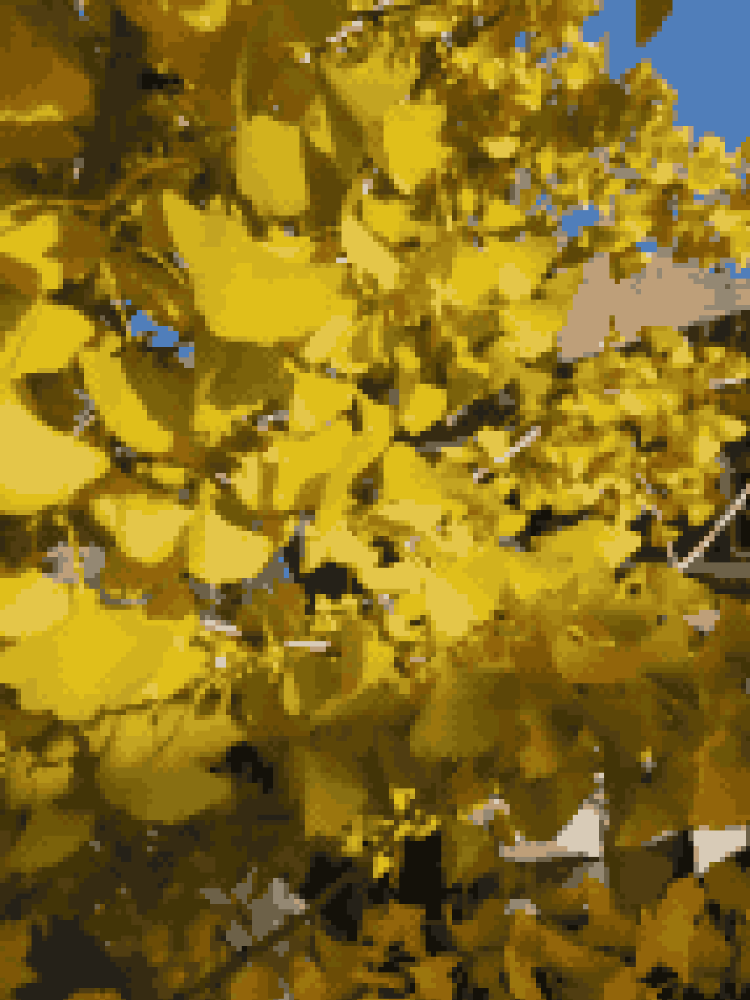
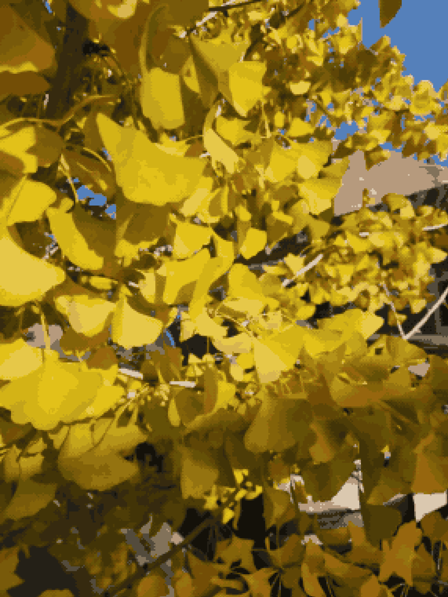

# DitherPal

A fast, feature-rich dithering desktop application built with PyQt6. Supports images and video with multiple dithering algorithms, full color modes, a one-click **Pixel Art Mode**, infinite upscaling, and Numba JIT acceleration.

---

## Examples

### Still Image

<table>
  <tr>
    <th>Original</th>
    <th>B&W Dither</th>
    <th>Full Color Dither</th>
  </tr>
  <tr>
    <td></td>
    <td></td>
    <td></td>
  </tr>
</table>

### Pixel Art Mode

Same photo, **Pixel Art Mode + Cel Shading** — the only thing changed between the two results is the **Upscale Factor**:

<table>
  <tr>
    <th>Original</th>
    <th>Pixel Art — 2× upscale</th>
    <th>Pixel Art — 4× upscale ⭐</th>
  </tr>
  <tr>
    <td></td>
    <td></td>
    <td></td>
  </tr>
</table>

> [!TIP]
> **Crank up the upscale factor!** Pixel Art Mode starts you at 2×, but **4× and beyond is where it really shines** — every step up gives you finer art pixels and brings back leaves, edges and small details. See [Pixel Art Mode](#pixel-art-mode-1) below.

### Video (Click to watch)

<table>
  <tr>
    <th>Original</th>
    <th>B&W Dither</th>
    <th>Full Color Dither</th>
  </tr>
  <tr>
    <td>
      <a href="https://youtu.be/6NttwZXAyww"></a>
    </td>
    <td>
      <a href="https://youtu.be/xMnGWsTfyyQ"></a>
    </td>
    <td>
      <a href="https://youtu.be/3B4rneGYVPo"></a>
    </td>
  </tr>
</table>

---

## Features

- **Multiple dithering algorithms** — Floyd-Steinberg, Jarvis-Judice-Ninke, Hybrid Bayer + Floyd-Steinberg, Bayer (2×2, 4×4, 8×8), Ordered, Rosette Pattern, Text Pattern
- **Pixel Art Mode** — Pick **High Res** or **Retro** and DitherPal analyzes your picture and sets everything up to turn it into pixel art
- **Depth-mapped pixel-art dithering** — Solid-color cel-shaded art pixels plus a dither modeled on real pixel art: Mark Ferrari-style fine gradient dithering (High Res) or Gen 3 Pokémon sprite-style seams (Retro)
- **Color modes** — Black & White, Full Color Spectrum, Custom palette
- **Infinite upscaling** — Super-sample before dithering for ultra-sharp output at any resolution (and finer pixel art)
- **Downscale (Pixelate)** — Dither at a fraction of the size, then scale back up with hard pixel edges
- **Video support** — Process MP4, AVI, MOV, MKV, WebM and more; outputs upscaled dithered MP4
- **Numba JIT acceleration** — Compiled dithering kernels for near-native CPU performance
- **Multithreaded video processing** — Parallel frame batches scale to available CPU cores

---

## Requirements

```
PyQt6
numpy
Pillow
numba
opencv-python
scikit-learn  # optional, improves full-color palette generation
```

Install all dependencies:

```bash
pip install PyQt6 numpy Pillow numba opencv-python scikit-learn
```

---

## Usage

```bash
python ditherpal.py
```

1. Drag and drop or open an image/video file
2. Choose a dithering method and color mode
3. Set an upscale factor (e.g. 4× for sharper dithering)
4. Click **Process** — output saves automatically alongside the source file

---

## Pixel Art Mode

1. Open an image and pick a **Pixel Art Mode** (under *Select Image or Video*):
   - **High Res** — detailed pixel art in the style of Mark Ferrari's *Living Worlds* scenes: fine dithering between close shades on smooth gradients and in the distance, crisp flat color up close, and a texture map that brings out shingles, leaves and stone with clumpy dither that follows the photo's own detail
   - **Retro** — Gen 3 (Ruby/Sapphire/Emerald) Pokémon sprite style: flat shade bands with thin checkered seams where neighboring shades meet, wider seams on nearby objects
2. **Raise the Upscale Factor to 4× (or more)** — see below
3. Click **Process**

Both modes turn on **Cel Shading** automatically (it's required — every art pixel is one solid color). A depth map
estimated from the picture decides where the dithering goes, and **Pattern Strength** sets how much (0% = flat cel shading).
The dithering rules were measured from real pixel art: 11 *Living Worlds* scenes (about 22% of pixels dithered,
always between close shades, densest far away) and 145 Emerald sprites (thin 1–2 px seams between neighboring shades only).

**3D Zoom Animation** (still images, any dither method): pick **Animated GIF**, **MP4 video** or **Animated SVG** and
the picture becomes a 4-second loop that zooms in and back out in 3D. A sharp depth map (objects walled off from the
frame come forward, edges follow the photo) makes near things push in more than far ones; the photo is warped first and
every frame is then dithered with the chosen method and the first frame's palette, so colors don't flicker. In Pixel Art
Mode the SVG is drawn as vector art pixels; for other methods it is a flipbook of crisp PNG frames. Ordered dithers
(Bayer, rosette, pixel art) stay steady in motion; error diffusion (Floyd-Steinberg, Jarvis) shimmers as dots reshuffle.

> [!IMPORTANT]
> ### 🔍 Play with the Upscale Factor — it's the secret to great pixel art
>
> Pixel Art Mode sets the *Block Size* (how big each art pixel is) for a **2×** upscale. When you raise the
> **Upscale Factor** and leave the block size alone, every art pixel covers **less of the original picture** —
> so you get **more, finer art pixels** and the small details come back.
>
> - **2×** — chunky, bold pixel art; small details get lost
> - **4×** — ⭐ the sweet spot for most photos (the example above)
> - **6×–8×** — even finer detail for busy pictures
>
> **This is the only way to get the finer details**, and once you find the right factor for your picture it works
> nearly perfectly. Try a few values — processing takes seconds.
>
> #### 🎚️ Dial in the exact look: Upscale and Block Size work as a sliding window
>
> The two settings pull in opposite directions:
>
> - **Upscale Factor ↑** → closer to the original picture (more realism and detail)
> - **Block Size ↑** → chunkier, more pixel-art-like
>
> So you can slide between the two to land on exactly the pixel-art quality you want:
>
> 1. **Push the Upscale Factor up** until the details you care about (faces, text, edges) come through
> 2. **Nudge Block Size up in small steps** until it looks like pixel art again — stop when it looks right
> 3. Too blocky? Take Block Size back a step, or raise the upscale another notch and repeat
>
> What really matters is the ratio: an art pixel covers **Block Size ÷ Upscale** pixels of the original. 4× upscale with
> block 16 makes the same size art pixels as 2× with block 8. The higher upscale gives you finer steps to adjust in
> and a cleaner result. If you see the ⚠ warning at the top of the settings, pick a Block Size that's a multiple of
> the Upscale Factor so every art pixel comes out the same size.

**What Pixel Art Mode sets for you:**

| Setting | What it picks |
|---------|---------------|
| Method | Hybrid Bayer + Floyd-Steinberg, Grid style, 85% pattern strength (the pixel-art dither amount) |
| Art pixel grid | Measured from your picture's detail: it samples the image in regions and picks the chunkiest grid that still keeps ~89% of the detail. Busy photos get finer grids, simple cartoons chunkier ones |
| Colors | Cel Shading on, with a palette built from your image's own colors (gray bands for grayscale/line art) |
| Upscale | 2× to start — **raise it!** |

All settings stay editable. **Art Pixels Across Short Side** lets you override the grid directly (lower = chunkier).

**Cel Shading controls** (Grid style):

| Control | What it does |
|---------|--------------|
| Color Bands | Size of the palette built from your image (default 24). More = more faithful colors, fewer = flatter, more stylized |
| Shading Dither | Without a Pixel Art Mode: checkerboard shading between color bands on gradients (default 35%). 0% = perfectly flat bands. Pixel Art Modes use their own dithering instead |

With a **Custom palette** color mode, cel shading uses your colors instead of building a palette.

---

## Dithering Methods

| Method | Description |
|--------|-------------|
| Floyd-Steinberg | Error-diffusion; smooth gradients, natural look |
| Jarvis-Judice-Ninke | Wider error spread; finer detail retention |
| Hybrid Bayer + Floyd-Steinberg | Error diffusion woven with a Bayer pattern. Styles: **Grid** (uniform blocks — used by Pixel Art Mode), **Hatched** (right-angle diffusion, engraving-like lines), **Woven** (Bayer-modulated crosshatch) |
| Bayer 2×2 / 4×4 / 8×8 | Ordered threshold matrix; structured, retro feel |
| Ordered Dither | 4×4 Bayer variant |
| Rosette Pattern | CMYK halftone dot screening |
| Text Pattern | Custom text tiled as a halftone mask |

---

## Acknowledgements

Special thanks to **[LeoBorcherding](https://github.com/LeoBorcherding)** / **[BlueberryMathematics](https://github.com/BlueberryMathematics)** for color dithering implementation and speed optimizations.
