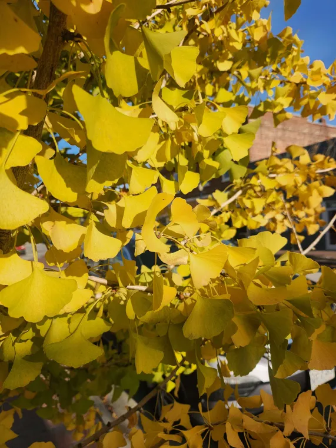
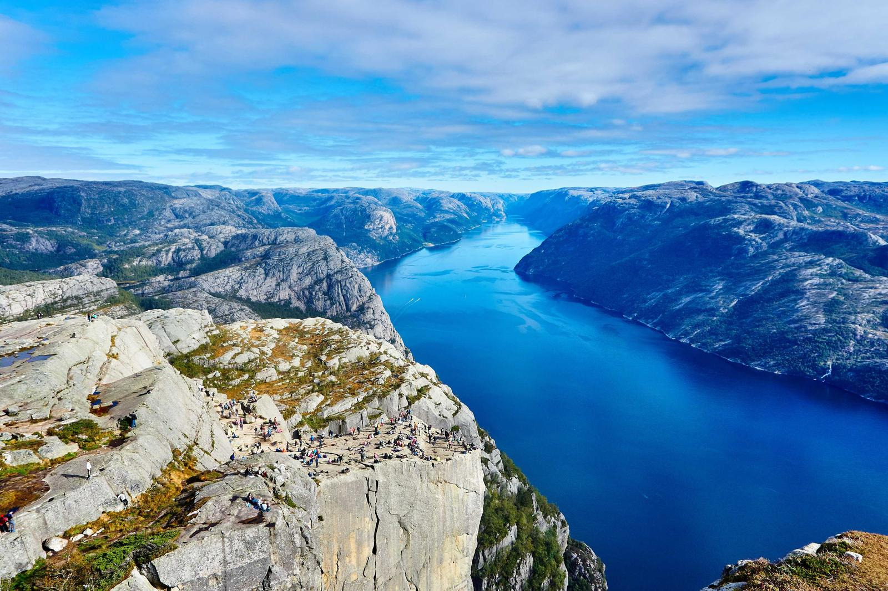
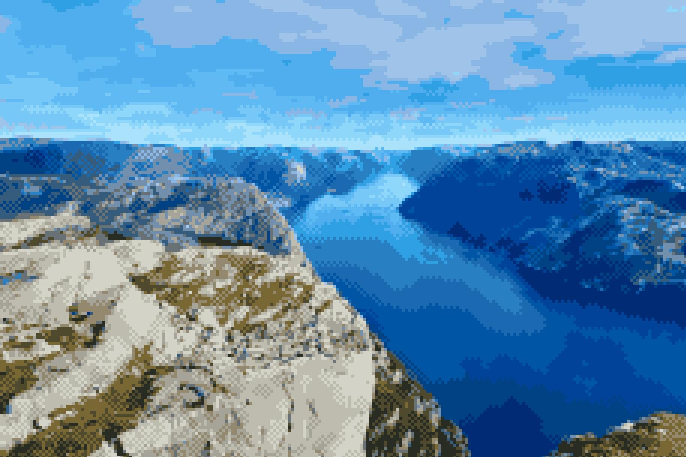
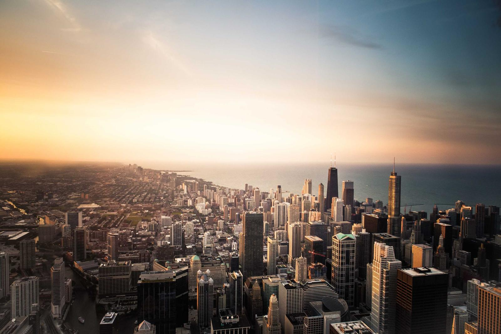
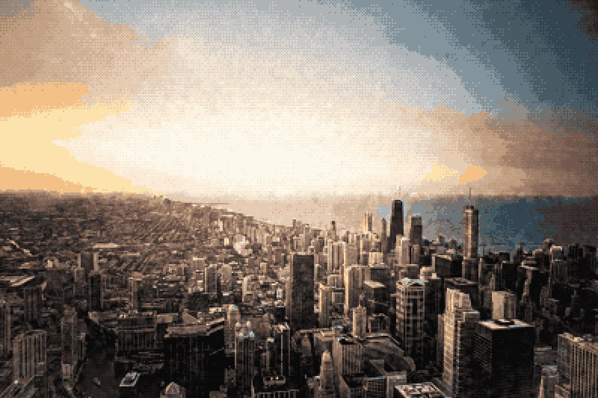

# DitherPal

A PyQt6 desktop app for dithering photos and video, rendering depth-aware pixel art,
and creating 3D camera animations from a photograph. **Neural depth is the shared
source for every depth-aware stage**: High Res shading, Retro seams, video frames,
and the textured 3D surface used for camera animation.

## Examples

### Still Image

These still-image examples predate neural depth becoming the default.

<table>
  <tr>
    <th>Original</th>
    <th>B&W Dither</th>
    <th>Full Color Dither</th>
  </tr>
  <tr>
    <td></td>
    <td></td>
    <td></td>
  </tr>
</table>

### Video (Click to watch)

<table>
  <tr>
    <th>Original</th>
    <th>B&W Dither</th>
    <th>Full Color Dither</th>
  </tr>
  <tr>
    <td>
      <a href="https://youtu.be/6NttwZXAyww"></a>
    </td>
    <td>
      <a href="https://youtu.be/xMnGWsTfyyQ"></a>
    </td>
    <td>
      <a href="https://youtu.be/3B4rneGYVPo"></a>
    </td>
  </tr>
</table>

### Pixel Art Mode

#### Retro

Flat color bands and checkerboard seams in a fjord landscape. Click either image
to inspect it at full size.

| Original | Retro |
| --- | --- |
| [](media/comparisons/fjord.jpg) | [](media/comparisons/fjord_Retro.jpg) |

Photo: [Alexey Topolyanskiy / Unsplash](https://unsplash.com/photos/-oWyJoSqBRM).

#### High Res

Fine dithered shading across a city skyline at sunset. Click either image
to inspect it at full size.

| Original | High Res |
| --- | --- |
| [](media/comparisons/city_skyline_sunset.jpg) | [](media/comparisons/city_skyline_sunset_High-Res.jpg) |

Photo: [Kevin Young / Unsplash](https://unsplash.com/photos/-icmOdYWXuQ).

> [!TIP]
> **Crank up the upscale factor!** Pixel Art Mode starts you at 2×, but **4× and beyond is where it really shines** — every step up gives you finer art pixels and brings back leaves, edges and small details. See [Pixel art](#pixel-art) below.

---

## Install

Use Python **3.12–3.14** in a virtual environment:

```bash
python3 -m venv .venv
source .venv/bin/activate
python -m pip install -r requirements.txt
python ditherpal.py
```

On Windows, activate with `.venv\Scripts\activate` instead. A graphical desktop is
required for the app. CPU inference works without CUDA or a dedicated GPU.
OpenCV uses its headless wheel because PyQt6 supplies the GUI. Use a fresh virtual
environment rather than installing multiple OpenCV variants together.

The first depth-aware operation downloads **Depth Anything V2 Small** (about
99 MB) into `models/`. The download is pinned and SHA-256 verified. Images are
processed locally. Later runs reuse the weights, an in-process ONNX session, and
cached source-image maps. Models and generated output are excluded from Git.
There is one Python environment; the app does not depend on an experimental folder.

To download the model ahead of time:

```bash
python -m ditherpal_depth --download-model
```

For an alternate writable model-cache directory, set `DITHERPAL_MODEL_DIR` before
starting the app. After the first successful download, depth inference works offline.
A model/load failure is reported explicitly; depth-aware jobs do not fall back to
texture-based estimates. Ordinary dithering methods that do not use depth still
work without downloading weights.

## Use

1. Select an image or video.
2. Choose a dither method and color mode, or select **High Res** / **Retro** Pixel Art Mode.
3. Adjust the art-pixel grid, block size, palette, and upscale factor as desired.
4. Click **Process Image**. Outputs save in `dithered/` beside the source, with
   numbered filenames when a version already exists.

The settings panel scrolls; the process controls remain visible. Block-size ratio
warnings overlay the settings and do not reserve a row or move the scroll area.

### One depth control

Click **Depth map** to open a compact neural-depth preview. It has one slider:

- **0%:** flat depth.
- **100%:** the model's estimated relative depth.
- **200%:** stronger separation between near and far.

White is near and black is far. Moving the slider updates the preview immediately
without running the model again. The selected strength is saved and used by the
next still-image, video, or 3D camera render. Video previews show their first frame;
processing uses a neural map for **each** video frame. There is no depth-source
selector, brush editor, or heuristic depth path.

Neural depth is relative, not a measurement in metres. The model can still make
mistakes on ambiguous scenes. The slider controls depth only; it does not change
your palette, dither method, or color settings.

### Pixel art

- **High Res:** solid cel-shaded art pixels with fine dithering between nearby
  shades. Neural depth, texture, and gradients control where shading appears.
- **Retro:** flat color bands with checkerboard seams between neighboring shades.
  Neural depth controls seam placement and width.

Both modes enable Cel Shading and start with a 2× upscale. The art-pixel grid is
suggested from image detail and stays editable. **Pattern Strength** controls the
amount of dithering; **Color Bands** controls the image-derived cel palette (4–64).
Custom-palette modes preserve your chosen colors.

Upscale and Block Size work together: an art pixel covers approximately
**Block Size ÷ Upscale Factor** source pixels. Raising upscale while holding block
size fixed creates finer art pixels. Increasing block size makes the result
chunkier. With "Scale result back to original size", choose a block size divisible
by the upscale factor for even-sized art pixels.

Depth is inferred from source RGB before grayscale conversion or cel shading,
then shared with the selected pixel-art style. Re-rendering the same unchanged
photo with different dither settings reuses the cached map.

### Neural 3D animation

For a still image, choose **Animated GIF**, **MP4 video**, or **Animated SVG** under
**Neural 3D Animation**. The app builds a textured triangle mesh from neural depth,
then renders a perspective camera moving in and out with a Z buffer. The old
image-warp zoom has been removed.

**AI detail**, **Camera travel**, **Side motion**, and **Fill small gaps** control
the camera render. The same depth-strength setting shapes the geometry, and its
projected depth drives pixel-art shading in each rendered frame. Every frame uses
your chosen dither method and a first-frame-locked palette. Animations contain
48 frames over four seconds and have a 2048-pixel output cap. SVG output is an
animated sequence of embedded raster frames.

**3D Mesh** beneath the result opens a standalone textured viewer in your browser.
You can orbit the geometry and show its triangles. OBJ/MTL, PLY, depth maps, raw
peak renders, uncovered-pixel masks, and a report are saved in `dithered/neural-zoom/`.

This is a single-photo visible-surface reconstruction, often called 2.5D. The
geometry has real XYZ coordinates and occlusion, but unseen object backs and
backgrounds remain unknown. Gap filling is a cosmetic correction, not recovered
geometry. Small camera motions usually work best.

### Video and GIF input

Choose **Video / GIF output** to export imported media as MP4 or animated GIF.
Frames are decoded in order, processed in bounded batches, and encoded
incrementally. A reusable thread pool handles dithering. **Lock video palette to
first frame** reduces repeated fitting and color shifts; disable it when later
scenes introduce substantially different colors.

High Res and Retro infer neural depth from each source frame before resizing and
share that map across its shading stages. Neural inference adds CPU work to video
processing; it does not drop frames. Non-depth-aware dither methods avoid that work.
A single-image depth model can still exhibit temporal variation on moving scenes.

GIF supports at most 256 colors per frame and centisecond timing. GIF export is
not inherently faster than MP4. Current video exports are silent: source audio
is not copied.

### Review and keep results

- **View:** open the selected result in your default image/media viewer.
- **Finalize:** copy it into `dithered/Finalized/`, preserving existing versions.
- **Comparison:** save a labeled original/result PNG in `dithered/Comparisons/`.
  The dither keeps its resolution; the original fits alongside it without cropping.
  Animations use the first frame. Older results can prompt for their original.
- **Recent:** browse up to 100 available outputs and restore one to the result
  viewer. The original and mesh associations are remembered across launches.
- **3D Mesh:** inspect the selected neural camera result's geometry.

Selecting a recent output leaves source-image and rendering controls in place.

## Dither methods and color limits

| Method | Description |
| --- | --- |
| Floyd–Steinberg | Error diffusion |
| Jarvis–Judice–Ninke | Wider grayscale diffusion; color currently uses Floyd–Steinberg |
| Hybrid Bayer + Floyd–Steinberg | Grid, Hatched, and Woven styles; Grid powers Pixel Art Mode |
| Bayer / Ordered | Ordered threshold patterns |
| Rosette | Color-channel halftone dots |
| Text Pattern | Custom text used as a halftone mask |

Output Levels ranges from 2–16. In full-color palette-based paths, levels 2–6
produce up to `levels³` RGB colors; larger settings learn an image palette capped
at 64 colors. Bayer/Ordered/Rosette use binary channel combinations. Text Pattern
can retain source RGB colors. Cel-shaded pixel art uses Color Bands instead; High
Res can add intermediate ramp shades. GIF encoding limits each frame to 256 colors.

## Development and GitHub

```bash
python -m pip check
QT_QPA_PLATFORM=offscreen python -m unittest discover -s tests -v
```

Tests mock neural inference where appropriate, so CI needs no GPU, model weights,
or image upload/download. Geometry tests exercise real projection, near-surface
occlusion, perspective-correct texture interpolation, and portable exports.
GitHub Actions runs the suite on Python 3.12 and 3.14.

Production depth code lives in `ditherpal_depth/`; `depth_editor.py` implements the
single-slider popup. The former `test-neural-zoom/` sandbox is local-only and ignored.
Do not add model weights, private photos, caches, virtual environments, credentials,
or generated media to commits. Existing files under `media/` are intentional examples.

To export a neural depth preview without launching the GUI:

```bash
python -m ditherpal_depth --image photo.jpg --output photo-depth.png
```

The preview is a 16-bit PNG at the cached depth-preview resolution. Choose a new
output filename; existing files are never overwritten by this command.

See [MODEL_NOTICE.md](MODEL_NOTICE.md) for model provenance and license links.

## Acknowledgements

Special thanks to **[LeoBorcherding](https://github.com/LeoBorcherding)** /
**[BlueberryMathematics](https://github.com/BlueberryMathematics)** for color dithering
implementation and speed optimizations. Neural depth uses
[Depth Anything V2 Small](https://github.com/DepthAnything/Depth-Anything-V2) and its
[ONNX Community conversion](https://huggingface.co/onnx-community/depth-anything-v2-small).
